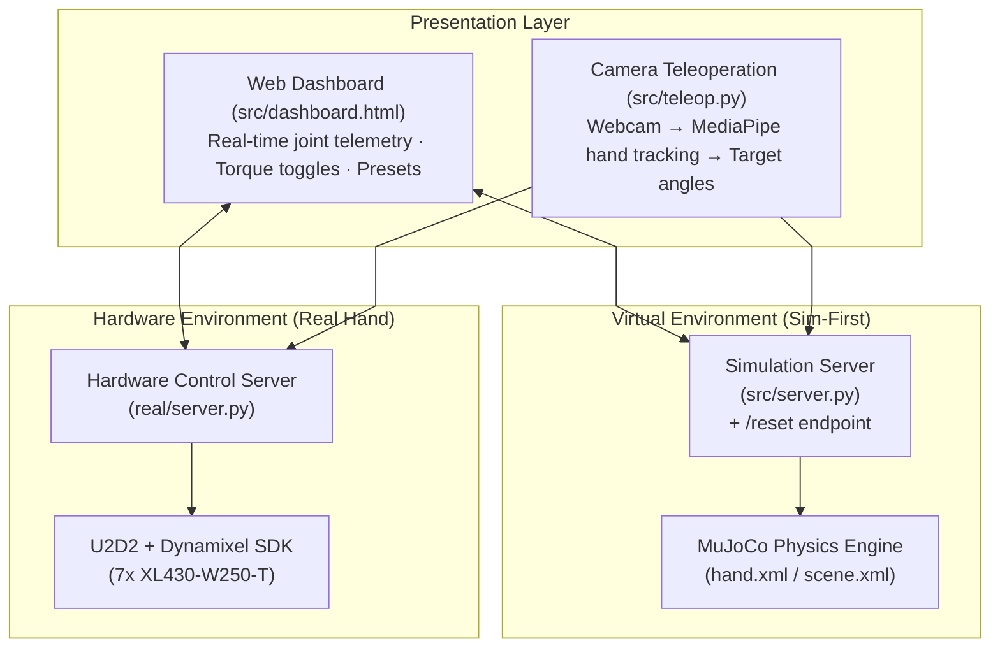

<p align="right">
  <b>English</b> | <a href="README.md">한국어</a>
</p>

# tri_hand: Sim-to-Real Robot Hand Control

**tri_hand** is a sim-to-real robotic manipulation platform for a 3-fingered, 7-DOF articulated robot hand. Kinematics, dynamics, and control policies are first verified in MuJoCo physics simulation, then deployed directly to physical hardware (7x Dynamixel XL430-W250-T actuators) using a unified HTTP REST API and web dashboard.

| MuJoCo Simulation | Real Robot Hand |
| :---: | :---: |
|  | <a href="https://youtu.be/c8-295kr47s" target="_blank"></a><br>[▶️ **Watch on YouTube**](https://youtu.be/c8-295kr47s) |

---

## System Architecture

The simulation (`src/server.py`) and hardware controller (`real/server.py`) share an **identical REST API and web dashboard**. Grasping postures, motion presets, and control logic tested in the virtual environment transfer directly to physical hardware with zero code changes.



---

## Key Features

* **Physics Simulation (MuJoCo)**: Full 3-finger, 7-DOF kinematic model (`hand.xml`, `scene.xml`) with decoupled visual STL meshes and primitive collision geometries for fast, stable contact dynamics.
* **Real Hardware Interface (`real/`)**: Synchronous 7-actuator control via Robotis U2D2 and Dynamixel SDK using single-packet `GroupSyncWrite`.
* **Web Dashboard & REST API**: Real-time telemetry monitoring (joint angles, velocities, loads, PID gains) and JSON-based preset dispatch.
* **Camera Teleoperation (`src/teleop.py`)**: Vision-based teleoperation retargeting human hand gestures to 3-finger kinematics in real time using MediaPipe.
* **Safety Interlocks & Telemetry**: Software joint limit clamping (HTTP 409 Conflict protection), smooth 0-rad homing, a 50 Hz hard-deadline control loop, and crash-resilient CSV logging.

---

## Quick Start (Virtual Simulation)

> 💡 **No physical hardware required.** Run the complete simulation, dashboard, and camera teleoperation pipeline locally on Windows, Linux, or macOS.

### Step 1: Environment Setup (Python 3.10 Recommended)

Clone the repository and set up a virtual environment:

```bash
# Clone the repository
git clone https://github.com/ajin-robot-hand/tri_hand.git
cd tri_hand
```

Create a virtual environment (`mujoco_env`) and install dependencies:

**Windows (PowerShell)**:
```powershell
python -m venv ..\mujoco_env
..\mujoco_env\Scripts\Activate.ps1
pip install -r requirements.txt
```

**Linux / macOS**:
```bash
python3.10 -m venv ~/mujoco_env
source ~/mujoco_env/bin/activate
pip install -r requirements.txt
```

<details>
<summary><b>Using uv</b></summary>

```bash
# Windows: uv venv ..\mujoco_env --python 3.10 && ..\mujoco_env\Scripts\Activate.ps1
uv venv ~/mujoco_env --python 3.10 && source ~/mujoco_env/bin/activate
uv pip install -r requirements.txt
```
</details>

> 📖 **OS-Specific Guide**: For Windows PowerShell execution policies (`Set-ExecutionPolicy`), webcam / COM port permissions, and diagnostic checks, refer to [**docs/environment_setup.md**](docs/environment_setup.md).

### Step 2: Launch Simulation & Teleoperation

Open **two separate terminals** to run the simulation backend and webcam teleoperation node side by side:

```bash
# [Terminal 1] Launch the simulation server
python src/server.py --headless
# (Omit --headless to open the interactive 3D viewer / On macOS: mjpython src/server.py)

# [Terminal 2] Launch camera teleoperation (Vision-based hand tracking)
python src/teleop.py
```

1. **Open the Web Dashboard**: Navigate to **[http://127.0.0.1:8000](http://127.0.0.1:8000)**
   - Click **`전체 토크 켜기` (Enable All Torque)** in the upper right.
   - Adjust individual joint sliders or select a grasp preset (e.g., `fist`, `pinch`) and click **`적용` (Apply)**.
2. **Camera Teleoperation**:
   - Position your hand in front of the webcam window opened by Terminal 2; the robotic hand follows your finger movements in real time.
   - Press `q` in the video preview window to exit.
3. **Shutdown**: Press `Ctrl + C` in Terminal 1.

> 📖 **Joint Retargeting (5-finger human ↔ 3-finger robot), Angular Velocity Limiting (3 rad/s), and Parameter Tuning**: Refer to [**docs/teleop.md**](docs/teleop.md).

---

## Real Hardware Control

> 💡 **Prerequisites**: Robotis U2D2, 7x Dynamixel XL430-W250-T actuators, and a DC 12V 5A power supply.

```bash
# 1) Verify physical connectivity and scan baudrate
python real/check.py

# 2) Launch hardware controller (smoothly homes to 0 rad before accepting commands)
python real/server.py
```

* Manage and monitor the physical hand through the same web dashboard interface at `http://127.0.0.1:8000`.
* 📖 **Actuator wiring, 5-step calibration, control gain conversion, and troubleshooting**: Refer to [**docs/hardware.md**](docs/hardware.md).

---

## Telemetry & Performance Benchmarks (KPIs)

Includes 50 Hz control loop jitter analysis, packet error tracking, system availability metrics, and a 24-hour endurance test harness (`real/endurance.py`).

* Launch with CSV telemetry logging: `python real/server.py --log logs`
* 📖 **Key Performance Indicators (KPIs) and experimental validation results**: Refer to [**docs/eval.md**](docs/eval.md).

---

## Running Tests

```bash
# Install test dependencies
pip install -r requirements-dev.txt

# Run the pytest test suite (126 tests)
python -m pytest tests
```

---

## Project Structure

```
tri_hand/
├── docs/       # Technical documentation & architecture specifications (architecture.md, hardware.md, etc.)
├── src/        # Simulation environment (hand.xml, server.py, teleop.py)
├── real/       # Physical robot control environment (server.py, check.py, calibrate.py)
└── tests/      # Unit and integration test suite
```

> 📖 **Full module index and detailed architecture**: Refer to [**docs/architecture.md**](docs/architecture.md).

---

## Team & Roles

* **Timeline**: 2026.08.12 ~ 2026.10.14 (Initial proposal ~ Final KPI validation)
* **Tech Blog**: [Stable Object Grasping with a 3-Fingered Articulated Robot Hand (KR)](https://ajin-robot-hand.github.io/docs/2026/10/tri-hand-basic/#3_1)

| Contributor | Focus Area |
| :--- | :--- |
| [@carryplz](https://github.com/carryplz) | Real Hardware |
| [@yeonjunky](https://github.com/yeonjunky) | Teleop, Dashboard |
| [@erdoslibrary](https://github.com/erdoslibrary) | Simulation |

---

## Acknowledgments

This project is built on the following open-source projects and libraries:

* [MuJoCo](https://mujoco.org/) - General-purpose physics engine by Google DeepMind
* [ROBOTIS Dynamixel SDK](https://github.com/ROBOTIS-GIT/DynamixelSDK) - Dynamixel Protocol 2.0 serial communication library
* [MediaPipe](https://github.com/google/mediapipe) - On-device real-time hand landmark tracking by Google
* [Chart.js](https://www.chartjs.org/) - Real-time telemetry visualization library for web dashboards

---

## Extension Project: padak-tri (Beat-Synchronized Choreography)

An extension project leveraging `tri_hand`'s MuJoCo kinematic model and Dynamixel drivers to orchestrate multi-joint robot hand choreography synchronized to music.

* **Repository**: [ajin-robot-hand/padak-tri](https://github.com/ajin-robot-hand/padak-tri)

| Physical Robot Hand Demo (Choreography Playback) |
| :---: |
| <a href="https://youtu.be/2_KnKuTeGbY" target="_blank"></a><br>[▶️ **Watch on YouTube**](https://youtu.be/2_KnKuTeGbY) |

---

## License

This project is licensed under the [MIT License](LICENSE).
