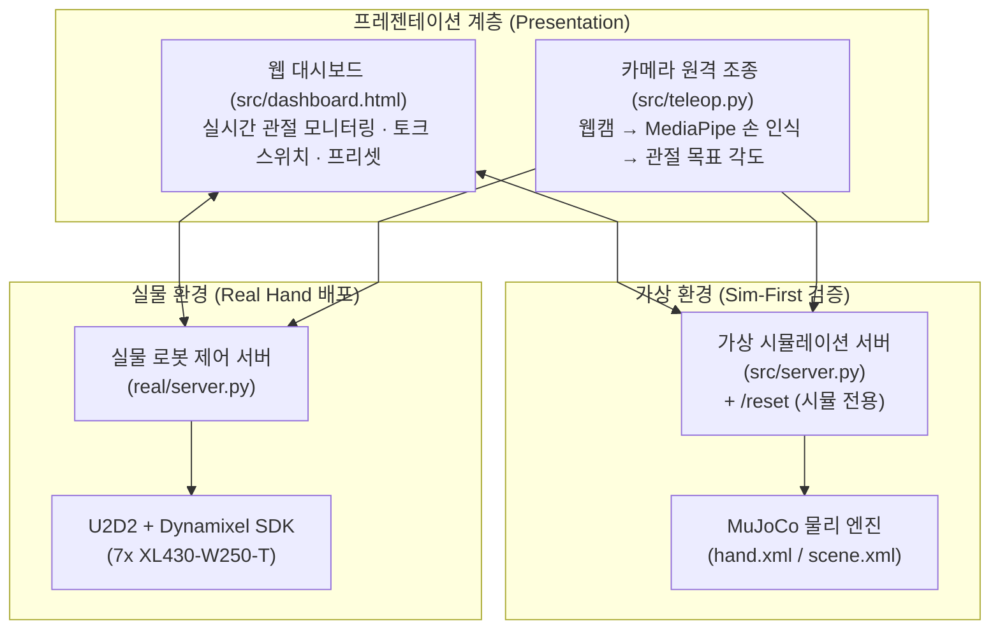

# tri_hand: Sim-to-Real 로봇 핸드 제어

손가락 3개와 독립적으로 움직일 수 있는 7개의 관절(7자유도, Degrees of Freedom)을 가진 로봇 손을 컴퓨터 가상 시뮬레이션 환경에서 먼저 검증하고 실제 하드웨어 로봇에 그대로 적용하는 가상-실물 연계(Sim-to-Real) 제어 프로젝트입니다.

MuJoCo 물리 시뮬레이션으로 기구학·동역학 및 제어 로직을 선행 검증하고, 동일한 HTTP REST API 규격과 웹 대시보드를 통해 실물 로봇(Dynamixel XL430-W250-T 7축)을 제어합니다.

| MuJoCo 시뮬레이션 (Simulation) | 실물 로봇 손 (Real) |
| :---: | :---: |
|  | <a href="https://youtu.be/c8-295kr47s" target="_blank"></a><br>[▶️ **YouTube에서 영상 보기**](https://youtu.be/c8-295kr47s) |

---

## 시스템 아키텍처

시뮬레이션(`src/server.py`)과 실물 로봇(`real/server.py`)이 **공용 REST API와 웹 대시보드**를 공유합니다. 가상 환경에서 검증한 파지 자세, 프리셋, 제어 로직을 실물 로봇에 그대로 적용할 수 있습니다.



---

## 핵심 기능

* **물리 시뮬레이션 (MuJoCo)**: 3지 7자유도 로봇 손 모델링 (`hand.xml`, `scene.xml`). 시각 메쉬(STL)와 충돌체(Primitive) 분리.
* **실물 하드웨어 인터페이스 (`real/`)**: U2D2 및 Dynamixel SDK 기반 7개 모터 동시 제어 (`GroupSyncWrite` 단일 패킷).
* **웹 대시보드 & REST API**: 관절별 각도, 속도, 토크, 게인 실시간 모니터링 및 JSON 기반 프리셋 제어.
* **카메라 원격 조종 (`src/teleop.py`)**: 일반 웹캠으로 사람 손을 인식하여 로봇 손가락 실시간 추종.
* **안전 인터록 및 계측 레이어**: 가동 범위 초과 보호(409), 부드러운 Homing, 50 Hz 고정 데드라인 루프 및 CSV 로깅.

---

## 빠른 시작 (가상 시뮬레이션)

> 💡 **실물 로봇이 없어도 일반 PC(Windows, Linux, macOS)에서 실행할 수 있습니다.**

### 1단계: 환경 구축 (Python 3.10 권장)

저장소를 클론하고 가상환경을 생성하여 의존성 패키지를 설치합니다:

```bash
# 저장소 클론 및 디렉토리 진입
git clone https://github.com/ajin-robot-hand/tri_hand.git
cd tri_hand
```

터미널 환경에 맞춰 가상환경(`mujoco_env`)을 생성하고 패키지를 설치합니다:

**Windows (PowerShell)**:
```powershell
python -m venv ..\mujoco_env
..\mujoco_env\Scripts\Activate.ps1
pip install -r requirements.txt
```

**Linux / macOS**:
```bash
python3.10 -m venv ~/mujoco_env
source ~/mujoco_env/bin/activate
pip install -r requirements.txt
```

<details>
<summary><b>uv 패키지 매니저를 사용하는 경우</b></summary>

```bash
# Windows: uv venv ..\mujoco_env --python 3.10 && ..\mujoco_env\Scripts\Activate.ps1
uv venv ~/mujoco_env --python 3.10 && source ~/mujoco_env/bin/activate
uv pip install -r requirements.txt
```
</details>

> 📖 **OS별 상세 가이드**: Windows PowerShell 실행 권한(`Set-ExecutionPolicy`), 내장 웹캠/U2D2 COM 포트 점검 및 환경 무결성 검증은 [**docs/environment_setup.md**](docs/environment_setup.md)를 참고하세요.

### 2단계: 시뮬레이션 및 원격 조종 실행 (대시보드 & 카메라 Teleop)

시뮬레이션 서버와 웹캠 원격 조종을 함께 활용할 수 있도록 **2개의 터미널**을 열어 각각 실행합니다:

```bash
# [1번 터미널] 시뮬레이션 서버 구동
python src/server.py --headless
# (3D 화면 창을 함께 띄우려면 --headless 없이 실행 / macOS는 mjpython src/server.py)

# [2번 터미널] 카메라 원격 조종 (웹캠 기반 실시간 손동작 추종)
python src/teleop.py
```

1. **웹 대시보드 접속**: **[http://127.0.0.1:8000](http://127.0.0.1:8000)**
   - 우측 상단 **`전체 토크 켜기`** 클릭
   - 슬라이더 조작 또는 프리셋(예: `fist`, `pinch`) 선택 후 **`적용`** 클릭
2. **카메라 원격 조종 (Teleoperation)**:
   - 2번 터미널 실행 시 열리는 웹캠 화면 앞에서 손을 움직이면 로봇 손이 실시간으로 따라 움직입니다.
   - 종료하려면 카메라 미리보기 창에서 `q` 키를 누릅니다.
3. **서버 종료**: 1번 터미널에서 `Ctrl + C`

> 📖 **사람 손(5지) ↔ 로봇 손(3지) 관절 매핑 원리, 각속도 제한(3 rad/s) 안전 인터록 및 사용자 튜닝**: [**docs/teleop.md**](docs/teleop.md)를 참고하세요.

---

## 실물 로봇 손 제어 (Real Hardware)

> 💡 **Robotis U2D2, Dynamixel XL430-W250-T 모터 7개, DC 12V 5A 전원이 필요합니다.**

```bash
# 1) 하드웨어 연결 및 Baudrate 자동 스캔
python real/check.py

# 2) 실물 제어 서버 실행 (0 rad 안전 Homing 후 대시보드 오픈)
python real/server.py
```

* 브라우저(`http://127.0.0.1:8000`)에서 시뮬레이션과 동일하게 실물 로봇을 제어합니다.
* 📖 **모터 배선, 캘리브레이션 5단계, 제어 게인 단위 차이점 및 트러블슈팅**: [**docs/hardware.md**](docs/hardware.md)를 참고하세요.

---

## 계측 로깅 및 성능 평가 (KPI)

50 Hz 제어 루프 지터, 패킷 에러율, 시스템 가용률 및 24시간 내구 구동 러너(`real/endurance.py`)를 제공합니다.

* CSV 계측 로깅 구동: `python real/server.py --log logs`
* 📖 **4대 KPI 평가 지표 및 상세 측정 결과**: [**docs/evaluation.md**](docs/evaluation.md)를 참고하세요.

---

## 테스트 실행

```bash
# 테스트 전용 의존성 설치
pip install -r requirements-dev.txt

# 테스트 스위트 실행 (총 126개 테스트)
python -m pytest tests
```

---

## 프로젝트 구조

```
tri_hand/
├── docs/       # 기술 문서 및 아키텍처 명세 (architecture.md, hardware.md 등)
├── src/        # 가상 시뮬레이션 환경 (hand.xml, server.py, teleop.py)
├── real/       # 실물 로봇 제어 환경 (server.py, check.py, calibrate.py)
└── tests/      # 단위 및 통합 테스트
```

> 📖 **모듈별 전체 파일 목록 및 상세 아키텍처**: [**docs/architecture.md**](docs/architecture.md)를 참고하세요.

---

## Team & Roles

* **기간**: 2026.08.12 ~ 2026.10.14 (개발 계획서 수립 ~ 최종 성능 평가)
* **블로그**: [3지 다관절 로봇손의 안정적 물체 파지](https://ajin-robot-hand.github.io/docs/2026/10/tri-hand-basic/#3_1)

| 팀원 | 담당 영역 |
| :--- | :--- |
| [@carryplz](https://github.com/carryplz) | Real Hardware |
| [@yeonjunky](https://github.com/yeonjunky) | Teleop, Dashboard |
| [@erdoslibrary](https://github.com/erdoslibrary) | Simulation |

---

## Acknowledgments

본 프로젝트는 아래의 오픈소스 기술 및 라이브러리를 기반으로 개발되었습니다:

* [MuJoCo](https://mujoco.org/) - Google DeepMind 다체 동역학 물리 시뮬레이션 엔진
* [ROBOTIS Dynamixel SDK](https://github.com/ROBOTIS-GIT/DynamixelSDK) - Dynamixel Protocol 2.0 시리얼 통신 라이브러리
* [MediaPipe](https://github.com/google/mediapipe) - Google 온디바이스 실시간 손 랜드마크 비전 솔루션
* [Chart.js](https://www.chartjs.org/) - 웹 대시보드 실시간 각도/토크 시각화 라이브러리

---

## 추가 확장 프로젝트: padak-tri (음악 동기화 안무)

본 프로젝트(`tri_hand`)의 MuJoCo 기구학 모델과 Dynamixel 제어 드라이버를 기반으로, 음악 비트에 맞춰 로봇 손이 춤추는 확장 과제입니다.

* **저장소**: [ajin-robot-hand/padak-tri](https://github.com/ajin-robot-hand/padak-tri)

| 실물 로봇 손 구동 데모 (안무 재생) |
| :---: |
| <a href="https://youtu.be/2_KnKuTeGbY" target="_blank"></a><br>[▶️ **YouTube에서 영상 보기**](https://youtu.be/2_KnKuTeGbY) |

---

## License

이 프로젝트는 [MIT License](LICENSE)를 따릅니다. 누구나 자유롭게 연구, 학습 및 상업적 용도로 수정·배포할 수 있습니다.
