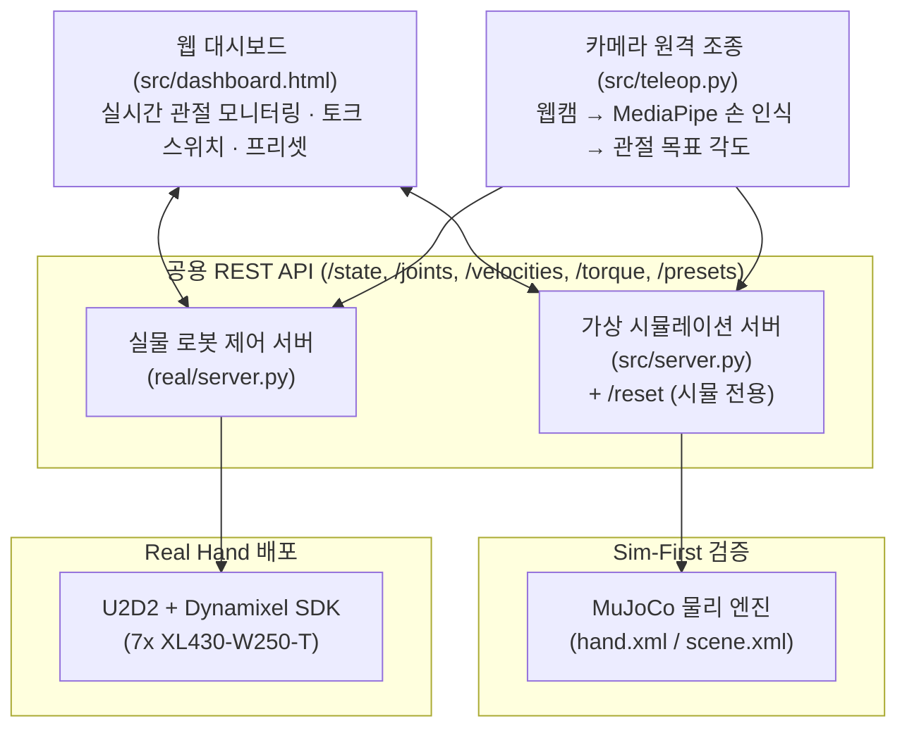

# tri_hand: Sim-to-Real 로봇 핸드 제어

3지 7자유도 다관절 로봇 손(`tri_hand`)을 위한 Sim-to-Real 제어 프레임워크입니다.

MuJoCo 물리 시뮬레이션으로 기구학·동역학 및 제어 로직을 선행 검증(Sim-First)하고, 동일한 HTTP REST API 규격과 웹 대시보드를 통해 실물 로봇(Dynamixel XL430-W250-T 7축)을 제어합니다.

| MuJoCo 시뮬레이션 (Sim-First) | 실물 로봇 손 (Real Hardware) |
| :---: | :---: |
|  | *(실물 로봇 구동 데모 영상)* |

---

## 🏛 시스템 아키텍처

시뮬레이션(`src/server.py`)과 실물 로봇(`real/server.py`)이 **공용 REST API와 웹 대시보드**를 공유합니다. 가상 환경에서 검증한 파지 자세, 프리셋, 제어 로직을 실물 로봇에 그대로 적용할 수 있습니다.



---

## ✨ 핵심 기능

* **물리 시뮬레이션 (MuJoCo)**: 3지 7자유도 로봇 손 모델링 (`hand.xml`, `scene.xml`). 시각 메쉬(STL)와 충돌체(Primitive) 분리.
* **실물 하드웨어 인터페이스 (`real/`)**: U2D2 및 Dynamixel SDK 기반 7개 모터 동시 제어 (`GroupSyncWrite` 단일 패킷).
* **웹 대시보드 & REST API**: 관절별 각도, 속도, 토크, 게인 실시간 모니터링 및 JSON 기반 프리셋 제어.
* **카메라 원격 조종 (`src/teleop.py`)**: 일반 웹캠으로 사람 손을 인식하여 로봇 손가락 실시간 추종.
* **안전 인터록 및 계측 레이어**: 가동 범위 초과 보호(409), 부드러운 Homing, 50 Hz 고정 데드라인 루프 및 CSV 로깅.

---

## ⚡ 빠른 시작 (가상 시뮬레이션)

> 💡 **실물 하드웨어가 없어도 일반 PC(Windows, Linux, macOS)에서 즉시 실행할 수 있습니다.**

### 1단계: 환경 구축 (Python 3.10 권장)

저장소를 클론하고 가상환경을 생성하여 의존성 패키지를 설치합니다:

```bash
# 저장소 클론 및 디렉토리 진입
git clone https://github.com/ajin-robot-hand/tri_hand.git
cd tri_hand
```

터미널 환경에 맞춰 가상환경(`mujoco_env`)을 생성하고 패키지를 설치합니다:

**Windows (PowerShell)**:
```powershell
python -m venv ..\mujoco_env
..\mujoco_env\Scripts\Activate.ps1
pip install -r requirements.txt
```

**Linux / macOS**:
```bash
python3.10 -m venv ~/mujoco_env
source ~/mujoco_env/bin/activate
pip install -r requirements.txt
```

<details>
<summary><b>uv 패키지 매니저를 사용하는 경우</b></summary>

```bash
# Windows: uv venv ..\mujoco_env --python 3.10 && ..\mujoco_env\Scripts\Activate.ps1
uv venv ~/mujoco_env --python 3.10 && source ~/mujoco_env/bin/activate
uv pip install -r requirements.txt
```
</details>

> 📖 **OS별 상세 가이드**: Windows PowerShell 실행 권한(`Set-ExecutionPolicy`), 내장 웹캠/U2D2 COM 포트 점검 및 환경 무결성 검증은 [**docs/environment_setup.md**](docs/environment_setup.md)를 참고하세요.

### 2단계: 시뮬레이션 실행 및 웹 브라우저 조작

1. **시뮬레이터 구동**:
   ```bash
   python src/server.py --headless
   ```
   *(3D 화면 창을 함께 띄우려면 `--headless` 없이 `python src/server.py` 실행 / macOS는 `mjpython src/server.py`)*

2. **웹 대시보드 접속**: **[http://127.0.0.1:8000](http://127.0.0.1:8000)**
   - 우측 상단 **`전체 토크 켜기`** 클릭
   - 관절 카드 슬라이더를 조작하거나 프리셋(예: `fist`, `pinch`)을 선택 후 **`적용`** 클릭
   - **종료**: 서버 터미널에서 `Ctrl + C`

---

## ✋ 카메라 원격 조종 (Teleoperation)

일반 웹캠 앞에서 사람 손을 움직여 로봇 손을 실시간 원격 조종합니다.

```bash
# 서버(src/server.py 또는 real/server.py)가 실행 중인 상태에서 새 터미널 실행:
python src/teleop.py
```

* 종료는 미리보기 창에서 `q`를 누릅니다.
* 📖 **사람 손(5지) ↔ 로봇 손(3지) 관절 매핑 원리, 각속도 제한(3 rad/s) 안전 인터록 및 사용자 튜닝**: [**docs/teleop.md**](docs/teleop.md)를 참고하세요.

---

## 🤖 실물 로봇 손 제어 (Real Hardware)

> 💡 **Robotis U2D2, Dynamixel XL430-W250-T 모터 7개, DC 12V 5A 전원이 필요합니다.**

```bash
# 1) 하드웨어 연결 및 보레이트 자동 스캔
python real/check.py

# 2) 실물 제어 서버 실행 (0 rad 안전 Homing 후 대시보드 오픈)
python real/server.py
```

* 브라우저(`http://127.0.0.1:8000`)에서 시뮬레이션과 동일하게 실물 로봇을 제어합니다.
* 📖 **모터 배선, 캘리브레이션 5단계, 제어 게인 단위 차이점 및 트러블슈팅**: [**docs/hardware.md**](docs/hardware.md)를 참고하세요.

---

## 📊 계측 로깅 및 성능 평가 (KPI)

50 Hz 제어 루프 지터, 패킷 에러율, 시스템 가용률 및 24시간 내구 구동 러너(`real/endurance.py`)를 제공합니다.

* CSV 계측 로깅 구동: `python real/server.py --log logs`
* 📖 **4대 KPI 평가 지표 및 상세 측정 결과**: [**docs/evaluation.md**](docs/evaluation.md)를 참고하세요.

---

## 🧪 테스트 실행

```bash
# 테스트 전용 의존성 설치
pip install -r requirements-dev.txt

# 테스트 스위트 실행 (총 121개 테스트)
python -m pytest tests
```

---

## 📁 프로젝트 구조

```
tri_hand/
├── docs/                       # 상세 기술 문서
│   ├── environment_setup.md    # OS별 환경 구축, 권한 설정 및 환경 검증
│   ├── teleop.md               # 카메라 원격 조종 매핑, 안전 기능 및 튜닝
│   ├── hardware.md             # 실물 하드웨어 스펙, 캘리브레이션 및 트러블슈팅
│   ├── evaluation.md           # 4대 KPI 평가 지표 및 24h 내구 시험 보고서
│   └── mujoco.gif              # 시뮬레이션 데모 미디어
├── src/                        # [가상 시뮬레이션] 모델 및 제어 환경
│   ├── scene.xml               # 전체 시뮬레이션 씬 (바닥, 조명 등)
│   ├── hand.xml                # 3지 7자유도 로봇 손 MuJoCo 물리 모델
│   ├── run_sim.py              # MuJoCo 뷰어 실행 데모
│   ├── server.py               # 시뮬레이션 HTTP 제어 서버
│   ├── teleop.py               # 웹캠 손 인식 원격 조종 (Sim/Real 공용)
│   └── dashboard.html          # 통합 제어 웹 대시보드
├── real/                       # [실물 로봇 제어] U2D2 + XL430 하드웨어 환경
│   ├── config.json             # 모터 ID, 통신 속도, zero, sign 설정
│   ├── check.py                # 하드웨어 진단 및 자동 스캔
│   ├── calibrate.py            # 관절별 ID 및 회전 방향 자동 탐색
│   ├── center.py               # 현재 자세를 0 rad 기준점으로 자동 보정
│   ├── server.py               # 실물 로봇 HTTP 제어 서버
│   └── endurance.py            # 24h 내구 구동 러너
├── tests/                      # 단위 및 통합 테스트 (pytest)
├── requirements.txt            # 실행 의존성 패키지
└── requirements-dev.txt        # 테스트 의존성 패키지
```
