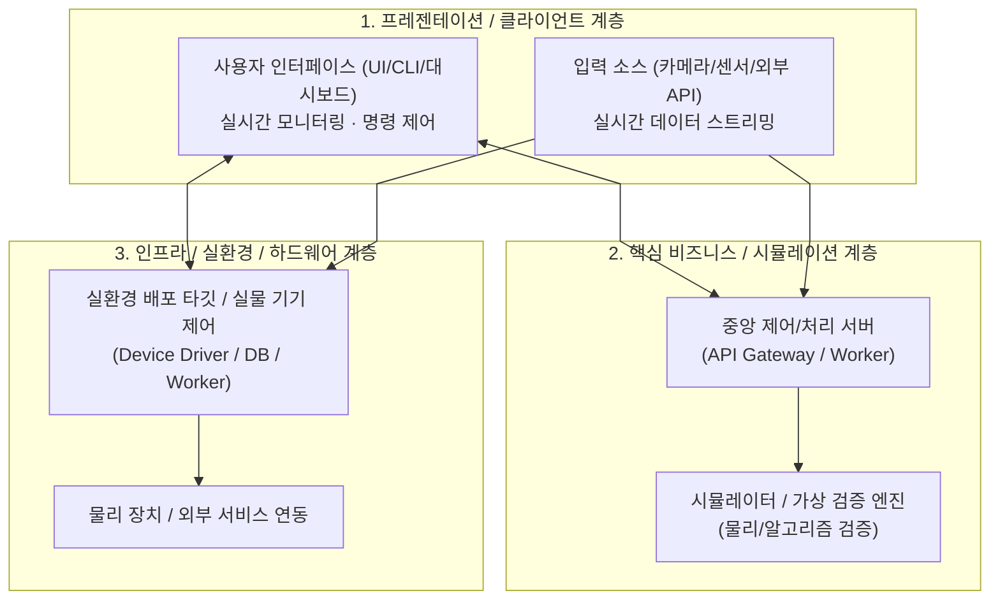

# [프로젝트 영문/한글 이름]: [프로젝트 핵심 슬로건/한 줄 설명]

> **[프로젝트의 핵심 역할 및 가치 제안을 1~2문장으로 요약합니다]**  
> 예: 3지 7자유도 다관절 로봇 손(`tri_hand`)을 위한 Sim-to-Real 제어 프레임워크입니다.

[](LICENSE)
[](https://www.python.org/)
[]()

[프로젝트 배경 및 핵심 동작 방식을 기술합니다. 어떤 문제를 해결하며, 어떤 검증 방식이나 기술적 접근을 취했는지 간결하게 설명합니다.]

| [환경/모드 A] (예: 가상 시뮬레이션 / 프론트엔드) | [환경/모드 B] (예: 실물 하드웨어 / 백엔드) |
| :---: | :---: |
|  | <a href="[영상_URL]" target="_blank"></a><br>[▶️ **YouTube에서 영상 보기**]([영상_URL]) |

---

## 시스템 아키텍처

[시스템 전체 구성과 데이터 흐름, 모듈 간의 통신 방식을 1~2문장으로 소개합니다.]



---

## 핵심 기능

* **[기능 1 이름]**: [단순 기능명이 아닌 기술적 특징과 이점을 명시합니다. 예: 물리 시뮬레이션 기반 기구학 사전 검증]
* **[기능 2 이름]**: [예: 단일 패킷 고속 동기화 통신을 통한 지연시간 최소화]
* **[기능 3 이름]**: [예: REST API 및 직관적인 웹 기반 실시간 제어 대시보드 제공]
* **[기능 4 이름]**: [예: 온디바이스 컴퓨터 비전 모델 기반 실시간 추종 제어]
* **[기능 5 이름]**: [예: 안전 인터록 계층(가동 범위 제한, 부드러운 Homing, 데드라인 루프)]

---

## 빠른 시작 (Quickstart)

> 💡 **[사전 준비 없이 누구나 즉시 로컬에서 테스트할 수 있는 최소 진입 경로를 안내합니다]**

### 1단계: 환경 구축 (Python 3.10 권장)

저장소를 클론하고 가상환경을 생성하여 의존성 패키지를 설치합니다:

```bash
# 저장소 클론 및 디렉토리 진입
git clone https://github.com/[조직_또는_유저명]/[저장소명].git
cd [저장소명]
```

사용 중인 운영체제(OS) 환경에 맞추어 가상환경을 생성하고 패키지를 설치합니다:

**Windows (PowerShell)**:
```powershell
python -m venv ..\[가상환경이름]
..\[가상환경이름]\Scripts\Activate.ps1
pip install -r requirements.txt
```

**Linux / macOS**:
```bash
python3 -m venv ~/[가상환경이름]
source ~/[가상환경이름]/bin/activate
pip install -r requirements.txt
```

<details>
<summary><b>uv 고속 패키지 매니저를 사용하는 경우 (클릭하여 펼치기)</b></summary>

```bash
# Windows
uv venv ..\[가상환경이름] --python 3.10 && ..\[가상환경이름]\Scripts\Activate.ps1
uv pip install -r requirements.txt

# Linux / macOS
uv venv ~/[가상환경이름] --python 3.10 && source ~/[가상환경이름]/bin/activate
uv pip install -r requirements.txt
```
</details>

> 📖 **OS별 상세 가이드**: 포트 충돌, 권한 설정, 주변기기 연결 점검 등 상세 가이드는 [**docs/environment_setup.md**](docs/environment_setup.md)를 참고하세요.

---

### 2단계: 실행 및 데모 구동

주요 컴포넌트(서버 및 클라이언트/원격제어)를 각각 분리된 터미널에서 구동합니다:

```bash
# [1번 터미널] 메인 서버 / 시뮬레이션 구동
python src/server.py

# [2번 터미널] 보조 클라이언트 / 원격 제어 인터페이스 구동
python src/teleop.py
```

1. **대시보드 / 메인 UI 접속**: 브라우저에서 **[http://127.0.0.1:8000](http://127.0.0.1:8000)** 접속
2. **동작 테스트**: 제어 패널에서 파라미터 조작 또는 프리셋 명령 전송
3. **종료**: 실행 중인 각 터미널에서 `Ctrl + C` (또는 GUI 창에서 `q` 키)

> 📖 **상세 제어 알고리즘 및 파라미터 튜닝**: [**docs/control_guide.md**](docs/control_guide.md)를 참고하세요.

---

## [선택 사항] 실환경 배포 / 실물 하드웨어 연동

> 💡 **(선택 사항)** 실제 물리 장치, 외부 클라우드, 프로덕션 환경 연동이 필요한 프로젝트인 경우 작성하며, 해당사항이 없으면 이 섹션을 삭제합니다.

```bash
# 1) 연결 상태 및 환경 사전 진단
python real/check.py

# 2) 실환경 서버/서비스 실행
python real/server.py
```

* 📖 **장비 세팅, 캘리브레이션 및 트러블슈팅**: [**docs/hardware.md**](docs/hardware.md)를 참고하세요.

---

## [선택 사항] 성능 평가 및 계측 (KPI / Benchmark)

> 💡 **(선택 사항)** 하드웨어 실시간 제어, 벤치마크 점수, 알고리즘 처리 성능(FPS/지연시간/처리량) 등 정량적 검증이 중요한 프로젝트에서 활용하며, 일반적인 앱/유틸리티 개발 시에는 생략 가능합니다.

[프로젝트의 신뢰성과 성능을 증명할 수 있는 정량적 지표(지터, 지연시간, 처리량, 에러율 등)를 기록합니다.]

* **실시간 계측/벤치마크 구동**: `python src/server.py --log logs`
* **주요 평가 지표 (Key Performance Indicators)**:
  - 제어 주기 / 레이턴시: `50 Hz (오차 < 1.0 ms)` 또는 `p99 지연시간 < 15ms`
  - 처리량 / 성공률: `99.9% 이상`
  - 장시간 내구 구동 안정성 통과
* 📖 **정량적 KPI 평가 지표 및 상세 측정 결과**: [**docs/evaluation.md**](docs/evaluation.md)를 참고하세요.

---

## 테스트 실행

```bash
# 개발/테스트 의존성 패키지 설치
pip install -r requirements-dev.txt

# 전체 단위 및 통합 테스트 실행
python -m pytest tests
```

---

## 프로젝트 구조

```
[프로젝트명]/
├── docs/       # 아키텍처, 셋업, 캘리브레이션 등 심층 기술 문서
├── src/        # 메인 소스 코드 (핵심 로직, 서버, 시뮬레이션, UI)
├── real/       # 실환경 / 하드웨어 인터페이스 코드 (선택적)
└── tests/      # 단위 및 통합 테스트 스위트
```

> 📖 **모듈별 전체 파일 목록 및 상세 아키텍처**: [**docs/architecture.md**](docs/architecture.md)를 참고하세요.

---

## Team & Roles

* **진행 기간**: 202X.0X.0X ~ 202X.0X.0X

| 팀원 | 담당 영역 | 주요 기여 내용 |
| :--- | :--- | :--- |
| [@깃허브아이디1](https://github.com/깃허브아이디1) | Hardware / Infra | 통신 드라이버 구현, 모터 캘리브레이션, 전원 제어 |
| [@깃허브아이디2](https://github.com/깃허브아이디2) | Frontend / Teleop | 웹 대시보드 구축, 실시간 원격 제어 파이프라인 |
| [@깃허브아이디3](https://github.com/깃허브아이디3) | Core / Simulation | 물리 시뮬레이션 모델링, REST API 서버 구축 |

---

## Acknowledgments

본 프로젝트는 아래 오픈소스 기술 및 라이브러리를 기반으로 개발되었습니다:

* [오픈소스_이름_1](링크) - 기술 개요 및 사용 용도
* [오픈소스_이름_2](링크) - 기술 개요 및 사용 용도
* [오픈소스_이름_3](링크) - 기술 개요 및 사용 용도

---

## License

이 프로젝트는 [MIT License](LICENSE)를 따릅니다.

---

<!--
================================================================================
💡 [부록] 엔지니어링 README 작성 가이드 & 모범 사례 (Best Practices)
(새 프로젝트에 적용 시 아래 부록 내용은 삭제하거나 사내/팀 가이드로 보관하세요)
================================================================================

1. 시각 자료 우선주의 (Visual First):
   - 방문자가 리포지토리에 들어와서 3초 안에 '무엇을 하는 프로젝트인지' 직관적으로 이해할 수 있어야 합니다.
   - 2열 테이블(| 시뮬레이션 | 실물 |)을 활용해 GIF와 YouTube 영상 링크를 나란히 배치하는 것이 가장 효과적입니다.
   - YouTube 링크는 이미지 썸네일(https://img.youtube.com/vi/[VIDEO_ID]/maxresdefault.jpg)과 클릭 링크를 조합합니다.

2. Mermaid 다이어그램 꺾임선 이슈 해결:
   - 다이어그램 선이 꼬이거나 글자를 관통하는 문제를 방지하기 위해 상단에 아래 설정을 반드시 포함합니다:
     %%{init: {'flowchart': {'curve': 'linear'}}}%%
   - 서브그래프(subgraph)를 3계층(프레젠테이션 -> 코어 서비스 -> 인프라/하드웨어)으로 나누면 가독성이 대폭 상승합니다.

3. 점진적 정보 공개 (Progressive Disclosure):
   - README 본문은 "누구나 5분 안에 로컬에서 구동해볼 수 있는 최소 절차"만 유지합니다.
   - 모든 기술적 디테일을 README 하나에 몰아넣지 말고, 주제별로 분리하여 docs/ 하위 문서로 딥링크합니다:
     * docs/environment_setup.md: OS별 트러블슈팅, 권한, venv/uv 가이드
     * docs/architecture.md: 모듈 인터페이스, 데이터 흐름, 설계 원칙
     * docs/hardware.md: 핀맵, 통신 프로토콜, 모터/센서 캘리브레이션
     * docs/evaluation.md: 벤치마크, 정량적 KPI 지표, 테스트 결과

4. 크로스 플랫폼 재현성 (OS Compatibility):
   - Windows(PowerShell), Linux, macOS 사용자가 명령어 복사-붙여넣기 시 실패하지 않도록 명확히 분리합니다.
   - 최신 트렌드인 uv 패키지 매니저는 <details> 태그로 감싸 README를 깔끔하게 유지합니다.

5. 정량적 엔지니어링 신뢰성 (KPI & Testing):
   - "잘 동작합니다" 대신 "50 Hz 주기, 지터 1.0 ms 미만, 패킷 에러율 0.1% 이하"처럼 정량 지표를 기재합니다.
   - pytest 실행 명령어와 테스트 통과 개수(예: 126 passed)를 명시하면 완성도와 신뢰도가 배가됩니다.

6. 프로젝트 성격에 따른 모듈형 섹션 (선택 사항 유연화):
   - '실환경 배포/하드웨어 연동' 및 '성능 평가 및 계측(KPI)' 섹션은 필수 항목이 아닙니다.
   - 로보틱스/임베디드/성능 집약적 시스템이 아닌 일반 웹, 백엔드 API, 라이브러리, CLI 도구 등에서는 해당 섹션을 삭제하거나 'API 사용 예시(Usage)' 또는 '배포 가이드(Deployment)'로 대체하여 가볍게 구성하세요.
-->
