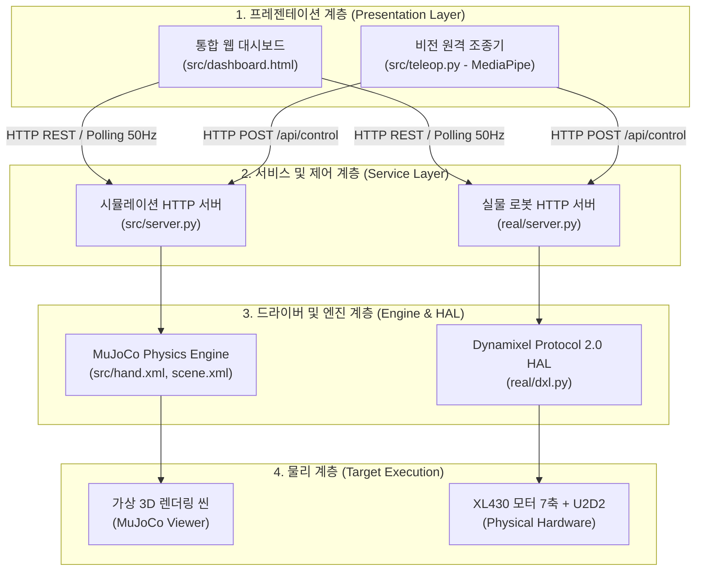

# tri_hand 시스템 아키텍처 및 소스코드 모듈 명세

본 문서는 3지 7자유도 로봇 핸드(`tri_hand`)의 전체 소프트웨어 아키텍처, 계층 구조, 디렉토리별 모듈 역할 및 인터페이스 세부 명세를 정의합니다.

---

## 1. 시스템 설계 철학 (Design Philosophy)

1. **Sim2Real 일관성 (Digital Twin Architecture)**
   - 가상 시뮬레이션([`src/server.py`](../src/server.py))과 실물 로봇 제어기([`real/server.py`](../real/server.py))가 **동일한 HTTP REST API 규격**을 공유합니다.
   - 단일 웹 대시보드([`src/dashboard.html`](../src/dashboard.html))로 코드 수정 없이 시뮬레이션 환경과 실물 하드웨어를 1:1로 교체 제어할 수 있습니다.

2. **하드웨어 안전 우선 (Fail-Safe & Interlock)**
   - **안전 Homing**: 실물 제어기 기동 시 급격한 자세 튐을 방지하기 위해 최소 2초간 부드럽게 0 rad(중립) 위치로 보간 이동 후 제어권을 넘깁니다.
   - **각속도 소프트웨어 인터록**: 비전 기반 원격 조종([`src/teleop.py`](../src/teleop.py)) 시 손 떨림이나 인식 튐으로 인한 모터 손상을 막기 위해 관절별 각속도를 최대 `3.0 rad/s`로 클램핑합니다.
   - **자동 고장 복구 (Auto-Recovery)**: 모터 부하 과다로 인한 `Hardware_Error` 알람 발생 시 세션 중단 없이 개별 모터를 안전하게 재부팅(Reboot)하고 토크를 재인가합니다.

3. **신뢰성 높은 계측 (Append-Only Telemetry)**
   - 24시간 연속 내구 구동 시 프로세스가 강제 종료되더라도 기록이 손상되지 않도록 flush가 보장되는 평면 CSV(Append-only) 구조를 채택했습니다.

---

## 2. 계층별 시스템 구조 (Layered Architecture)



---

## 3. 모듈별 상세 명세 (Component Specification)

### 3.1 `src/` : 가상 시뮬레이션 환경 (Virtual Simulation)

MuJoCo 물리 엔진 기반 가상 환경 모델링 및 웹 브라우저 기반 GUI/제어 인터페이스를 담당합니다.

| 파일명 | 역할 및 주요 책임 | 주요 함수 / 클래스 / 특징 |
| :--- | :--- | :--- |
| [`scene.xml`](../src/scene.xml) | 시뮬레이션 환경 전역 씬 설정 | 바닥 평면(ground plane), 조명, 카메라, 물리 솔버 옵션, -Y 중력(`0 -9.81 0`) 정의 |
| [`hand.xml`](../src/hand.xml) | 3지 7자유도 로봇 핸드 물리 모델 | 3D 시각 메쉬(`group 1`)와 충돌체 프리미티브(`group 3`) 분리, 모터 한계 토크(1.4 N·m), PD 제어 게인(kp=12, kv=0.5) 정의 |
| [`server.py`](../src/server.py) | 시뮬레이션 제어 백엔드 HTTP 서버 | `SimulationHandler`, 50 Hz 백그라운드 물리 스텝 루프, REST API 제공 및 `dashboard.html` 정적 서빙 |
| [`run_sim.py`](../src/run_sim.py) | MuJoCo 네이티브 뷰어 데모 러너 | 로컬 GUI 뷰어 렌더링 및 `--headless` 백그라운드 물리 유효성 검증 러너 |
| [`teleop.py`](../src/teleop.py) | 웹캠 비전 기반 원격 조종 클라이언트 | MediaPipe Hands 랜드마크 추출, 5지 $\to$ 3지 기구학 매핑, 3 rad/s 안전 속도 필터 |
| [`dashboard.html`](../src/dashboard.html) | 올인원 실시간 제어 대시보드 | Chart.js 기반 실시간 각도/토크 그래프, 관절 슬라이더, 토크 온/오프, 게인 튜닝, 프리셋 로드/저장 |
| [`presets.json`](../src/presets.json) | 관절별 프리셋 포즈 데이터 | 기본 홈 자세, 물병 파지, 카드 파지, 펜 파지 등의 7관절 목표 각도(rad) 보관 |
| `meshes/` | 3D CAD 표면 메쉬 파일 | `palm.stl`(손바닥 베이스), `unit.stl`(단위 관절 링크) |

---

### 3.2 `real/` : 실물 하드웨어 제어 스택 (Real Hardware Control)

Dynamixel XL430-W250-T 7개 모터와 Robotis U2D2 인터페이스를 직접 제어하고 진단·계측합니다.

| 파일명 | 역할 및 주요 책임 | 주요 함수 / 클래스 / 특징 |
| :--- | :--- | :--- |
| [`dxl.py`](../real/dxl.py) | DYNAMIXEL SDK Protocol 2.0 래퍼 | `DxlClient`, `GroupSyncRead`(위치/속도/전류/온도 일괄 수신), `GroupSyncWrite`(목표각 일괄 송신), 모터 리부트/토크 인가 |
| [`server.py`](../real/server.py) | 실물 로봇 제어 백엔드 HTTP 서버 | 0 rad 안전 Homing 구동, 50 Hz 제어/상태 루프, 지터 측정(`LoopStats`), 하드웨어 에러 감지 및 자동 복구 |
| [`config.py`](../real/config.py) | 하드웨어 설정 로더 및 검증기 | `RobotConfig`, `JointConfig` 데이터클래스, 포트/보레이트 및 관절별 zero tick / sign 유효성 검증 |
| [`config.json`](../real/config.json) | 실물 기구 파라미터 저장소 | 장치 포트(`/dev/ttyUSB0`), 통신 속도(`1000000`), 관절별 모터 ID, 영점 tick, 회전 방향 부호(`sign`) |
| [`check.py`](../real/check.py) | 연결 진단 및 보레이트 자동 스캔 | 7개 ID 핑 확인, 미응답 모터 발생 시 57.6k~4M bps 전 대역 스캔으로 누락 모터 자동 탐색, `--watch` 실시간 모니터링 |
| [`calibrate.py`](../real/calibrate.py) | 5단계 인터랙티브 캘리브레이션 마법사 | 수동 관절 조작을 안내하여 각 관절의 ID, 회전 부호(`sign`), 영점 tick을 순차적으로 탐색 및 검증 |
| [`center.py`](../real/center.py) | 원클릭 영점 보정 도구 | 실물 로봇 손을 중립 자세(0 rad)로 정렬한 상태에서 실행 시 현재 위치를 `config.json`의 `zero`로 자동 갱신 |
| [`check_grasp.py`](../real/check_grasp.py) | 파지 동작 검증 스크립트 | 프리셋별 파지 동작을 순차 구동하며 각 관절의 부하 및 도달 여부를 테스트 |
| [`runlog.py`](../real/runlog.py) | Append-Only CSV 텔레메트리 로깅 엔진 | `RunLogger`, 1 Hz 관절 샘플(`joint_sample.csv`), 에러 이벤트(`error_event.csv`), 가동률 세션(`run.csv`) 기록 |
| [`endurance.py`](../real/endurance.py) | 24시간 연속 내구 구동 러너 | 장시간 파지/복귀 반복 사이클 구동, 패킷 에러율 및 시스템 가용률 실시간 산출 |
| [`presets.json`](../real/presets.json) | 실물 전용 프리셋 포즈 데이터 | 실물 모터 특성에 맞춘 파지 프리셋 설정 |

---

### 3.3 `tests/` : 소프트웨어 품질 보증 (Test Suite)

`pytest`를 기반으로 가상 환경, 통신 계층, 제어 로직, 안전 인터록을 검증하는 121개 테스트 스위트입니다.

| 파일명 | 검증 대상 및 주요 시나리오 |
| :--- | :--- |
| [`test_server.py`](../tests/test_server.py) | 가상 시뮬레이션 HTTP 엔드포인트(`GET /api/state`, `POST /api/control`, 프리셋 API 등) 정상 응답 검증 |
| [`test_real.py`](../tests/test_real.py) | Mock DYNAMIXEL SDK를 이용한 `DxlClient` 패킷 송수신, 각도 $\leftrightarrow$ Tick 변환, 에러 처리 검증 |
| [`test_real_server.py`](../tests/test_real_server.py) | 실물 제어 서버의 시작 시 안전 Homing 루틴, 각속도 제한, 비상 정지(E-Stop) 및 REST 핸들러 검증 |
| [`test_teleop.py`](../tests/test_teleop.py) | 사람 5지 랜드마크에서 로봇 3지 각도 변환 수학 알고리즘 및 3 rad/s 속도 제한 인터록 검증 |
| [`test_endurance.py`](../tests/test_endurance.py) | 내구 시험 통계 산출(패킷 에러율, 가용률), `RunLogger` CSV 파일 생성 및 Flush 무결성 검증 |

---

### 3.4 `docs/` : 기술 문서 체계 (Documentation Framework)

| 문서명 | 주요 내용 |
| :--- | :--- |
| [`environment_setup.md`](environment_setup.md) | Ubuntu/WSL2 파이썬 가상환경 구축, U2D2 udev 시리얼 권한 및 FTDI 1ms 레이턴시 튜닝 가이드 |
| [`hardware.md`](hardware.md) | XL430 모터 배선, 캘리브레이션 5단계 절차, 제어 게인 단위 차이점 및 하드웨어 트러블슈팅 |
| [`teleop.md`](teleop.md) | 사람 손 ↔ 로봇 손 관절 매핑 수식, 3 rad/s 안전 인터록 원리 및 웹캠 튜닝 가이드 |
| [`evaluation.md`](evaluation.md) | 4대 KPI(50Hz 제어 주기 지터, 파지 성공률, 패킷 에러율 <0.05%, 가용률 >99%) 상세 평가 보고서 |
| [`eval.md`](eval.md) | 로봇 핸드 개발 원본 계획서 및 개정 이력 (Amendments R1, R2) |
| [`architecture.md`](architecture.md) | *(본 문서)* 시스템 아키텍처 및 소스코드 전체 모듈 세부 명세 |

---

## 4. 핵심 데이터 인터페이스 규격 (API Schema)

가상/실물 서버는 공통으로 다음 RESTful API를 제공합니다:

* **`GET /api/state`**
  - 주기: 20~50 Hz (대시보드 폴링)
  - 응답 포맷:
    ```json
    {
      "time": 14.32,
      "joints": {
        "A_j0": { "pos": 0.0, "vel": 0.0, "torque": 0.0, "goal": 0.0, "temp": 32.0, "torque_enable": true },
        ...
      },
      "kpi": { "loop_freq_hz": 50.1, "jitter_ms": 0.23, "packet_error_rate": 0.0 }
    }
    ```
* **`POST /api/control`**
  - 목표 각도 지령 송신: `{"A_j0": 0.52, "A_j1": -0.85, ...}`
* **`POST /api/gains`**
  - 관절별 제어 게인 및 토크 한계 갱신: `{"joint": "A_j0", "kp": 12.0, "kv": 0.5, "torque_limit": 1.4}`
* **`POST /api/torque`**
  - 개별 또는 전체 모터 토크 온/오프 제어: `{"joint": "A_j0", "enable": true}`
